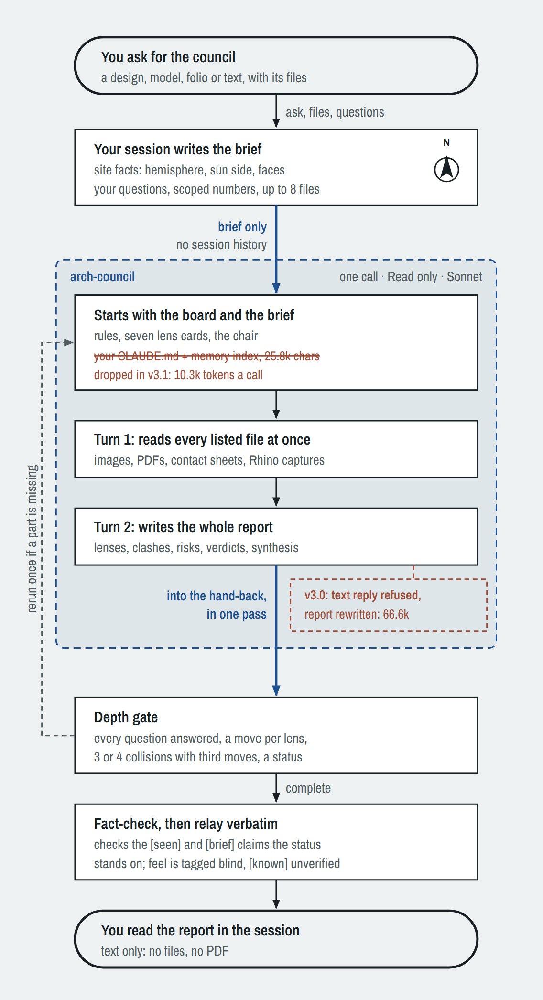
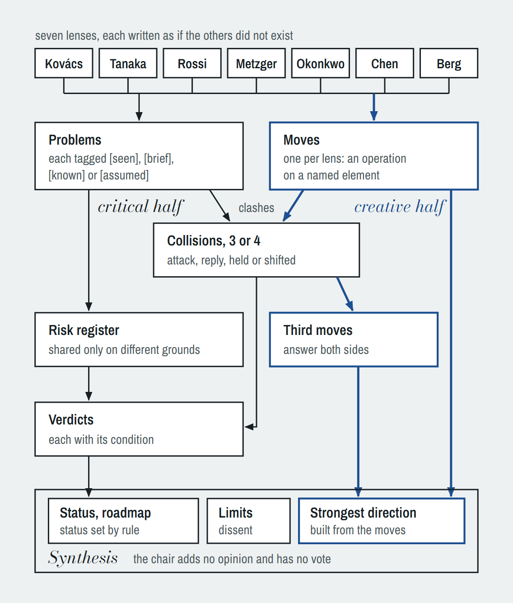
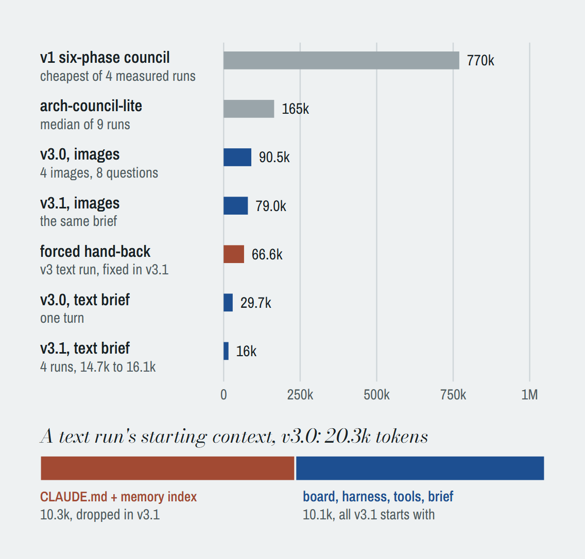

# Architectural Council

An architectural review board for Claude Code in one agent call. Seven architect lenses with incompatible convictions and a neutral chair review a design, model, folio or text, and the report comes back as text in the session: sealed lenses that each propose a move, collisions that end in a third move, a risk register, verdicts with conditions, and a synthesis with a status, a roadmap and the strongest direction. "lite" or "quick crit" gives a 500-word read from the same board.

## How it works

<picture>
  <source media="(prefers-color-scheme: dark)" srcset="docs/run-dark.png">
  
</picture>

**One run.** Your session writes the brief and makes a single call to a Read-only agent, which sees the brief and nothing else from the session. It reads the listed files in its first turn and writes the whole report in its second. A depth gate sends an incomplete report back once; your session then checks the claims the status rests on and relays the report unchanged. Red marks what v3.1 removed: the user's CLAUDE.md and memory index in every call, and the report written twice when it came back as a text reply.

<picture>
  <source media="(prefers-color-scheme: dark)" srcset="docs/inside-dark.png">
  
</picture>

**Inside the board.** Each lens is written as if the others did not exist. The critical half tags every problem by its evidence (`[seen]`, `[brief]`, `[known]`, `[assumed]`), sets the lenses against each other in three or four collisions, counts a risk as shared only when lenses reach it on different grounds, and ends in verdicts with conditions. The creative half asks each lens for one move on a named element, a third move that answers both sides of each collision where one exists, and a strongest direction assembled from the moves.

<picture>
  <source media="(prefers-color-scheme: dark)" srcset="docs/cost-dark.png">
  
</picture>

**Cost per run**, to scale, from the subagent transcripts.

## Stats

Measured in November 2026 from the subagent transcripts (the v3 runs with `council_cost.py`): the council agent's input tokens, cache reads and writes included, plus its output. The main session's own work (the brief, the fact check) is not counted. The v3 text runs all used one brief and the image runs another, with four images and an 8-question checklist; the v1 and lite rows are real reviews of different projects. v3 runs on Sonnet.

| Version | Agent calls | Tokens per run |
|---|---|---|
| v1, six phases (4 runs) | 21 to 48 subagents | 0.77M to at least 6.47M |
| Lite, one general-purpose agent (9 runs) | 1 | 70k to 2.11M, median 165k |
| v3.0, text brief | 1 | 29.7k |
| v3.0, text brief, report written twice | 1, 2 turns | 66.6k |
| **v3.1, text brief (4 runs)** | **1** | **14.7k to 16.1k** |
| **v3.1, Quick length** | **1** | **11.0k** |
| v3.0, four images and 8 questions | 1, 2 turns | 90.5k |
| **v3.1, the same images and questions** | **1, 2 turns** | **79.0k** |

v1's cost was its subagent count, not its prompts: each general-purpose subagent carried the whole tool and skill roster (65k to 72k tokens on the test machine) before it read a word.

What the v3.1 tests showed (one run per test, so indicative):

- **One pass.** None of the 7 v3.1 runs wrote its report twice (v3.0: 1 of 3).
- **Half the starting context.** A text run starts at 9.7k to 10.1k tokens, down from 20.3k, because the board no longer carries the user's CLAUDE.md and memory index.
- **Images.** All four images read and all eight checklist questions answered, for 79.0k tokens against 90.5k on v3.0.
- **Outside facts.** With the reach rule, every lens brought one fact from its own field that the brief did not contain (7 of 7). With the final history rule, five of seven brought a real one, the building's own history among them, and two restated the brief.
- **Quick length.** 11.0k tokens and 603 words, against a 500-word target.

## Install

By hand: copy `agents/arch-council.md` to `~/.claude/agents/` and the folder `skills/architectural-council/` to `~/.claude/skills/`, then start a new Claude Code session (agent files load at startup).

As a plugin: this folder is a plugin root (`.claude-plugin/plugin.json`). Put it in a local plugin marketplace and install `architectural-council` from there. The agent may then be listed as `architectural-council:arch-council`; the skill uses whichever name the agent list shows.

## Files

| File | Role |
|---|---|
| `skills/architectural-council/SKILL.md` | The controller: how the main session writes the brief, runs the board, checks and relays |
| `agents/arch-council.md` | The board: protocol, report template, the seven lens cards and the chair |
| `skills/architectural-council/README.md` | History, measured token costs and traps |
| `skills/architectural-council/council_cost.py` | Prints the token cost of every council run on the machine, from the local subagent transcripts |
| `docs/` | The figures in this README, light and dark |

## Security

- The board's only tool is Read, and it reads only the files the brief lists. It cannot write files, run commands or reach the network.
- It starts without the user's CLAUDE.md files (`omitClaudeMd: true`), so personal instructions and memory stay out of its context.
- `council_cost.py` reads local transcripts and prints token counts and run descriptions to the terminal. It makes no network calls and runs no commands.

## Version

v3.1, November 2026. It replaces v1 (April 2026), which ran six phases across 20 to 48 subagents per review and wrote a PDF.
